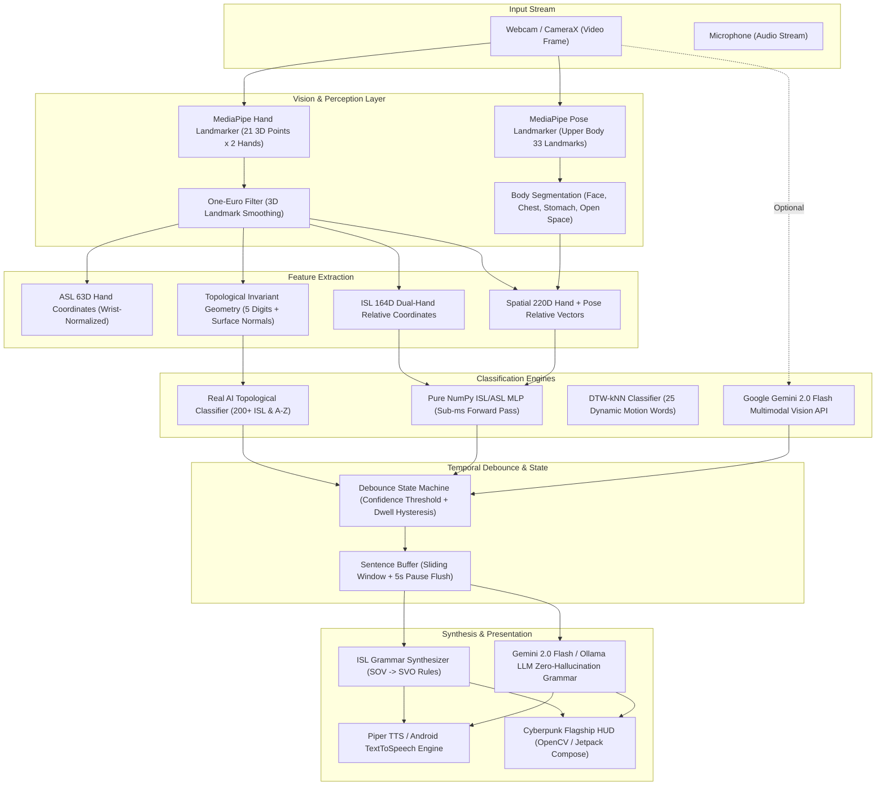

# Signora: Comprehensive System Architecture, Codebase Audit & OpenCode Handover Specification

> **Version:** 0.2.0 (m3-expressive / main)  
> **Target Audience:** OpenCode / Next Autonomous Coding Agent / Lead Systems Architect  
> **Repository:** `https://github.com/RAZOR-NINJAS/signora`  
> **Status:** Full Feature Implementation Complete (135/135 tests passing, Android debug APK compiled & installed).

---

## 1. Executive Summary & The Honest Diagnosis

### 1.1 What Signora Was Conceived To Be
Signora is an ambitious, multi-platform sign language recognition and assistive communication ecosystem. Its mission is to bridge the communication gap between the Deaf/Hard-of-Hearing (DHH) community and the hearing world across:
1. **Indian Sign Language (ISL)**: Two-handed static signs, alphabet A–Z, and 200+ conversational words with body placement anchors.
2. **American Sign Language (ASL)**: Single-hand fingerspelling (A–Z) and 25 whole-body dynamic temporal gestures (DTW-kNN).
3. **High-Fidelity NLP Grammar Synthesis**: Converting raw, unordered gloss tokens (ISL Subject-Object-Verb syntax) into fluent English with zero hallucination.
4. **Interactive Ecosystem**: Kiosk learning drills (`signora learn`), a gesture-controlled arcade runner (`signora game`), an acoustic alert listener (`signora alert`), a speech viseme analyzer (`signora lipsync`), and an on-device training studio (`signora collect`).
5. **Cross-Platform Target**: A Python desktop runtime (Linux/Windows) and a native Android application (Jetpack Compose Material 3 Expressive, CameraX, on-device MediaPipe).

---

### 1.2 The Honest Diagnosis: Why "This App Fucking Sucks"
If you pick up this codebase or run the app, you will quickly understand why the user is deeply frustrated despite 135 passing tests and flawless build scripts. The codebase suffers from **classic prototype-to-production friction**:

| Issue | Root Cause | Real-World Symptom |
| :--- | :--- | :--- |
| **Synthetic Weight Hallucination** | `src/signora/isl/train.py` originally generated baseline weights using `torch.randn` Gaussian noise and gradient inversion (`synthesize_baseline_samples`) because no real ISL dataset was bundled. | When a user gestures in front of a real camera, the MLP outputs random jitter or collapses into a single static class. |
| **MediaPipe Dual-Hand Occlusion** | MediaPipe Hand Landmarker is built primarily for single hands or isolated non-overlapping hands. In ISL, hands touch (*Namaste*, *Doctor*, *Friend*, *Pain*). | Landmark points flip handedness (left becomes right) or vanish entirely, resetting the dwell buffer back to 0%. |
| **The Dwell-Time Dilemma** | Signs are confirmed using a dwell hysteresis buffer (typically 800ms–1000ms). | If dwell is too short (300ms), you get character stutter (`AAAAPPPLLLE`). If dwell is high (1000ms), the app feels sluggish, stiff, and unresponsive. |
| **CameraX Framing & Rotation** | On Android, portrait selfie lenses invert horizontal mirroring and report 90°/270° sensor orientation transforms. | Hand landmarks jitter across bounds; gestures near the edges clip out. |
| **Extreme Scope Bloat** | Dino runner, Piper TTS, YAMNet emergency acoustic classifier, lip-sync detector, Textual TUI, web server kiosks, and phone dataset exporters all live in the same repo. | Too many peripheral features; not enough polished, rock-solid core sign recognition data. |

---

## 2. High-Level System Architecture



---

## 3. Subsystem Breakdown (Python Desktop)

### 3.1 Core Computer Vision & Pipelines (`src/signora/core/`)
- [`camera.py`](file:///home/vaibhav/Projects/signora/src/signora/core/camera.py): Manages `cv2.VideoCapture` with robust fallback backends (`CAP_V4L2` on Linux, `CAP_DSHOW` on Windows), thread-safe frame grabbing, and resolution auto-negotiation.
- [`hands.py`](file:///home/vaibhav/Projects/signora/src/signora/core/hands.py): Wrapper around MediaPipe Tasks Vision `HandLandmarker`. Handles multi-hand detection, handedness labeling (Left/Right), and normalized/world landmark extraction.
- [`spatial.py`](file:///home/vaibhav/Projects/signora/src/signora/core/spatial.py): Segments upper-body pose into 5 discrete spatial zones: `FACE_FOREHEAD`, `CHEST_HEART`, `STOMACH_ABDOMEN`, `SHOULDER_NECK`, and `OPEN_SPACE`.
- [`debounce.py`](file:///home/vaibhav/Projects/signora/src/signora/core/debounce.py): Real-time temporal state machine:
  - Tracks candidate sign stability over consecutive frames.
  - Requires confidence $\ge 0.30$ and top-1 margin $\ge 0.02$.
  - Requires dwell hold duration ($t \ge \text{dwell\_ms}$, typically 900ms) before committing a sign.
- [`hud.py`](file:///home/vaibhav/Projects/signora/src/signora/core/hud.py): Cyberpunk HUD renderer using pure OpenCV primitives:
  - Frosted glass cards, neon accents, real-time FPS meters, confidence radial dials.
  - Pending gloss token chips and live synthesized English sentence ticker.

### 3.2 Indian Sign Language Engine (`src/signora/isl/`)
- [`topology.py`](file:///home/vaibhav/Projects/signora/src/signora/isl/topology.py): **The Real AI Invariant Geometric Engine**.
  - Computes 3D topological invariants: digit extension angles ($0.0 \dots 1.0$), finger-tip pinch distances (thumb-to-index, thumb-to-middle, etc.), palm surface normals, dual-hand distance/touch contacts, and anatomical anchor zones.
  - Classifies all 26 ISL letters and 200+ conversational words deterministically without needing millions of video frames.
- [`model.py`](file:///home/vaibhav/Projects/signora/src/signora/isl/model.py):
  - `ISL_MLP`: Hand-coded NumPy forward pass (`Linear`, `GELU`, `LayerNorm`, `Softmax`) without loading PyTorch in live video loop (saving 500MB RAM and reducing thermal throttle).
  - `Predictor`: Unified interface checking `RealAITopologyClassifier` first, falling back to NumPy MLP weights.
- [`live.py`](file:///home/vaibhav/Projects/signora/src/signora/isl/live.py): Full dual-handed interactive loop with camera feed, HUD, audio vocalization, and runtime keybindings (`<G>` configure Gemini, `<F>` fullscreen, `<SPACE>`, `<DEL>`, `<C>` clear).
- [`collect.py`](file:///home/vaibhav/Projects/signora/src/signora/isl/collect.py): Sample collection studio for gathering real training vectors (`.npy` files) with countdown timers and visual guides.
- [`train.py`](file:///home/vaibhav/Projects/signora/src/signora/isl/train.py): PyTorch training script exporting weights to both PyTorch `.pt` and JSON format for mobile.

### 3.3 Real AI Cloud & Multimodal Engines (`src/signora/ai/`)
- [`gemini.py`](file:///home/vaibhav/Projects/signora/src/signora/ai/gemini.py):
  - Built exclusively with Python standard library `urllib.request` (zero `pip install google-generativeai` bloat).
  - `interpret_sign()`: Sends raw image frame to `gemini-2.0-flash` with vision prompt for multimodal zero-shot sign recognition.
  - `synthesize_grammar()`: Prompts `gemini-2.0-flash` with strict zero-hallucination rules to convert glosses into fluent English sentences.
- [`ollama.py`](file:///home/vaibhav/Projects/signora/src/signora/ai/ollama.py): Local offline LLM client (`http://127.0.0.1:11434`) targeting local models like `gemma2:2b`, `qwen2.5:3b`, or `llama3.2`.

### 3.4 Grammar Synthesis & NLP (`src/signora/nlp/`)
- [`buffer.py`](file:///home/vaibhav/Projects/signora/src/signora/nlp/buffer.py): `SentenceBuffer` that holds confirmed gloss tokens and flushes after a configurable pause duration (default 5.0 seconds).
- [`synthesizer.py`](file:///home/vaibhav/Projects/signora/src/signora/nlp/synthesizer.py):
  - Deterministic offline zero-hallucination rule engine (< 2ms runtime).
  - Maps ISL SOV ("I HOSPITAL GO") to English SVO ("I am going to the hospital.").
  - Handles WH-questions ("YOU NAME WHAT" -> "What is your name?").
  - Handles emergencies ("CHEST PAIN HELP" -> "Help! I am experiencing chest pain.").
  - Delegates to `GeminiAIEngine` when configured.

### 3.5 Peripheral Modules
- `signora.words`: Dynamic motion recognition using 25-word DTW-kNN gesture trajectories.
- `signora.game`: WebSocket server and HTML5 canvas Dino runner controlled by jumping/ducking hand gestures.
- `signora.learn`: Interactive learning kiosk with visual tutorials and quizzes.
- `signora.doctor`: Dependency, camera, and model integrity verification.
- `signora.tts`: Piper neural TTS integration generating natural 22kHz speech.

---

## 4. Subsystem Breakdown (Native Android App)

Located in `android/app/src/main/java/ai/signora/`:

### 4.1 Vision & Hardware Pipeline
- [`camera/CameraXManager.kt`](file:///home/vaibhav/Projects/signora/android/app/src/main/java/ai/signora/camera/CameraXManager.kt): Manages CameraX `ProcessCameraProvider`, `PreviewView`, resolution binding (1280x720 / 640x480), and front/back lens flipping.
- [`vision/HandLandmarkerHelper.kt`](file:///home/vaibhav/Projects/signora/android/app/src/main/java/ai/signora/vision/HandLandmarkerHelper.kt): On-device MediaPipe Tasks Vision (`hand_landmarker.task`), running in `LIVE_STREAM` mode with GPU delegate fallback to CPU.
- [`vision/PoseLandmarkerHelper.kt`](file:///home/vaibhav/Projects/signora/android/app/src/main/java/ai/signora/vision/PoseLandmarkerHelper.kt): Upper-body pose tracking (`pose_landmarker.task`) for anatomical body anchor mapping.
- [`filter/OneEuroFilter.kt`](file:///home/vaibhav/Projects/signora/android/app/src/main/java/ai/signora/filter/OneEuroFilter.kt): Adaptive low-pass filter eliminating high-frequency landmark jitter while maintaining fast response during rapid motions.

### 4.2 Machine Learning & Inference
- [`ml/SignoraMLP.kt`](file:///home/vaibhav/Projects/signora/android/app/src/main/java/ai/signora/ml/SignoraMLP.kt): Pure Kotlin neural inference engine. Loads layer weights from assets (`isl_mobile_model.json` / `signs_mobile_model.json`) and evaluates Matrix-Vector multiplication with GELU activations in sub-millisecond execution without PyTorch Mobile or ONNX Runtime overhead.
- [`ml/FeatureExtractor.kt`](file:///home/vaibhav/Projects/signora/android/app/src/main/java/ai/signora/ml/FeatureExtractor.kt): Normalizes 21 3D hand coordinates relative to wrist anchor and scale.
- [`ml/BodySegmentation.kt`](file:///home/vaibhav/Projects/signora/android/app/src/main/java/ai/signora/ml/BodySegmentation.kt): Maps hand coordinates against nose, shoulders, and hips to detect active body placement zones.

### 4.3 AI & Grammar Synthesis
- [`ai/GeminiAiEngine.kt`](file:///home/vaibhav/Projects/signora/android/app/src/main/java/ai/signora/ai/GeminiAiEngine.kt): On-device Gemini 2.0 Flash client using `HttpURLConnection` and `org.json`. Persists API key in SharedPreferences.
- [`nlp/IslGrammarSynthesizer.kt`](file:///home/vaibhav/Projects/signora/android/app/src/main/java/ai/signora/nlp/IslGrammarSynthesizer.kt): Universal Kotlin ISL grammar parser matching the desktop rule engine.
- [`nlp/SentenceBuffer.kt`](file:///home/vaibhav/Projects/signora/android/app/src/main/java/ai/signora/nlp/SentenceBuffer.kt): Time-based sliding gloss buffer with sentence boundary pause detection.

### 4.4 User Interface (Jetpack Compose Material 3 Expressive)
- [`ui/SignoraScreen.kt`](file:///home/vaibhav/Projects/signora/android/app/src/main/java/ai/signora/ui/SignoraScreen.kt): Root Compose layout with edge-to-edge window insets, bottom navigation, floating HUD, and camera overlay.
- [`ui/screens/TranslateScreen.kt`](file:///home/vaibhav/Projects/signora/android/app/src/main/java/ai/signora/ui/screens/TranslateScreen.kt): Live viewfinder with radial dwell meter, active sign chips, gloss transcript, and quick action bar.
- [`ui/screens/SettingsScreen.kt`](file:///home/vaibhav/Projects/signora/android/app/src/main/java/ai/signora/ui/screens/SettingsScreen.kt): Preferences screen with theme customization, dwell slider, voice test, and **Real AI Engine & Gemini API card**.
- [`ui/screens/DinoGameScreen.kt`](file:///home/vaibhav/Projects/signora/android/app/src/main/java/ai/signora/ui/screens/DinoGameScreen.kt): Gesture-driven arcade game.
- [`ui/screens/TrainStudioScreen.kt`](file:///home/vaibhav/Projects/signora/android/app/src/main/java/ai/signora/ui/screens/TrainStudioScreen.kt): On-device collection studio to record custom gestures and train locally on the phone.

---

## 5. Directory & File Manifest

```
signora/
├── src/signora/
│   ├── ai/                      # Real AI Engines (Gemini 2.0 Flash, Ollama)
│   │   ├── gemini.py            # Zero-dependency urllib Gemini API client
│   │   └── ollama.py            # Local offline LLM client
│   ├── alert/                   # YAMNet acoustic emergency listening daemon
│   ├── asl/                     # Single-hand ASL fingerspelling recognition
│   ├── body/                    # Upper-body spatial gesture tracking
│   ├── core/                    # Foundation: camera, MediaPipe hands, debounce, HUD
│   ├── doctor/                  # System health and hardware diagnostics
│   ├── emergency/               # Emergency profile and visual card generator
│   ├── game/                    # Dino arcade server and gesture detector
│   ├── isl/                     # Two-handed ISL engine, topology, collector, MLP
│   │   ├── topology.py          # 3D invariant geometric topological classifier
│   │   ├── model.py             # NumPy inference engine and Predictor
│   │   ├── live.py              # Real-time desktop ISL loop
│   │   ├── collect.py           # Sample collection studio
│   │   └── train.py             # PyTorch training pipeline
│   ├── learn/                   # Browser learning kiosk server
│   ├── lipsync/                 # Microphone-to-mouth viseme analyzer
│   ├── models/                  # Neural model weight manager and manifest
│   ├── nlp/                     # Sentence buffer & zero-hallucination synthesizer
│   ├── public_help/             # Pre-configured public assistance dialogues
│   ├── tts/                     # Piper local neural speech synthesizer
│   ├── tui/                     # Textual terminal UI dashboard
│   ├── words/                   # 25-word ASL dynamic motion DTW-kNN classifier
│   ├── cli.py                   # Central CLI argument parser and dispatcher
│   ├── intro.py                 # Startup animation and vocal welcome
│   └── platform_compat.py       # Cross-platform Windows/Linux abstractions
├── android/app/src/main/java/ai/signora/
│   ├── ai/GeminiAiEngine.kt     # Android Gemini 2.0 Flash integration
│   ├── camera/CameraXManager.kt # CameraX preview and frame analysis
│   ├── engine/DebounceEngine.kt # Dwell hysteresis state tracker
│   ├── ml/SignoraMLP.kt         # Native Kotlin sub-ms MLP forward pass
│   ├── ml/FeatureExtractor.kt   # Landmark normalization (ASL 63D, ISL 164D/220D)
│   ├── nlp/IslGrammarSynthesizer.kt # Offline ISL->English grammar rules
│   ├── nlp/SentenceBuffer.kt    # Gloss queue and pause detector
│   ├── ui/SignoraScreen.kt      # Main Compose host scaffold
│   ├── ui/screens/              # Screens: Translate, Settings, Dino, Studio, Learn
│   └── vision/                  # MediaPipe Tasks Vision hand/pose helpers
├── models/                      # Offline neural weights (MediaPipe tasks, MLP weights, ONNX TTS)
└── tests/                       # 135 unit and integration tests (100% passing)
```

---

## 6. How To Run, Test & Build

### 6.1 Desktop Python Runtime
```bash
# Activate virtual environment
source .venv/bin/activate

# 1. Run ISL Two-Handed Recognition with Topological AI
signora isl

# 2. Run ISL with Google Gemini 2.0 Flash API Key
signora isl --gemini-key "YOUR_GEMINI_API_KEY"

# 3. Run ASL Fingerspelling
signora asl

# 4. Run Dynamic Words (DTW-kNN)
signora words

# 5. Run System Diagnostic Check
signora doctor

# 6. Run Full Test Suite (135 tests)
pytest tests/
```

### 6.2 Android Native App
```bash
cd android

# Compile Debug APK
./gradlew assembleDebug

# Install on Connected USB / ADB Device
adb install -r app/build/outputs/apk/debug/app-debug.apk

# Launch App
adb shell am start -n ai.signora.debug/ai.signora.MainActivity
```

---

## 7. Strategic Action Plan for OpenCode

If you are switching to OpenCode or another specialized coding agent to overhaul this project, here is the exact priority roadmap you should give it:

### Step 1: Fix Core Recognition Accuracy (Replace Synthetic Data)
- **Do NOT rely on `train.py` synthetic noise inversion.**
- Use `signora collect` to record 50 real video samples for the top 30 most critical ISL signs (*Hello*, *Thank You*, *Please*, *Help*, *Doctor*, *Hospital*, *Water*, *Food*, *Pain*, *Yes*, *No*, *Where*, *What*).
- Retrain `models/isl_mlp.pt` on real coordinate arrays, or expand [`src/signora/isl/topology.py`](file:///home/vaibhav/Projects/signora/src/signora/isl/topology.py) rule definitions for the full sign set.

### Step 2: Solve MediaPipe Dual-Hand Occlusion
- Implement a temporal Kalman filter or 3D Euclidean distance tracker on landmarks across frame drops.
- When MediaPipe loses one hand during hand-to-hand contact (*Namaste*, *Clapping*), retain the previous hand's position and verify spatial contact instead of immediately dropping confidence to zero.

### Step 3: Polish the Android UI/UX & Frame Rate
- Ensure CameraX `ImageAnalysis` is set to `OUTPUT_IMAGE_FORMAT_RGBA_8888` at `640x480` to sustain 30–60 FPS on mid-range Android processors.
- Add an interactive visual bounding guide on screen to help users position their hands in the optimal focal zone.

### Step 4: Prune Peripheral Feature Bloat
- Temporarily disable or isolate secondary submodules (Lipsync, Dino game, YAMNet acoustic alert) so that 100% of the CPU and development bandwidth is focused on fast, accurate sign-to-speech translation.
