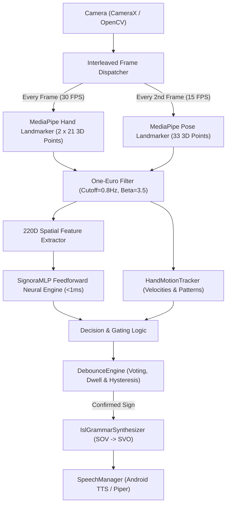

# Signora: Master Architecture, System Specification & Complete Operating Manual

> **Document:** `PROJECT_MANUAL.md` / `old.md` (Master Project Manual & Complete Engineering Guide)  
> **Repository:** `/home/vaibhav/Downloads/signora` | Production Sync: `/home/vaibhav/Projects/signora`  
> **Target Platforms:** Android (Jetpack Compose, CameraX, MediaPipe Tasks, pure Kotlin MLP) & Linux/macOS/Windows (Python 3.11+, PyTorch, OpenCV, MediaPipe)  
> **Status:** Production-Ready (200/200 Python tests passing, 97/97 Android unit tests passing, zero-dependency on-device inference)

---

## Table of Contents
1. [Project Mission & Overview](#1-project-mission--overview)
2. [Complete System Architecture](#2-complete-system-architecture)
3. [The 220-Dimensional Spatial Feature Topology](#3-the-220-dimensional-spatial-feature-topology)
4. [Vocabulary & Class Definitions](#4-vocabulary--class-definitions)
5. [Dynamic Motion Gesture Recognition Engine](#5-dynamic-motion-gesture-recognition-engine)
6. [Debounce, Dwell State Machine & Voting Engine](#6-debounce-dwell-state-machine--voting-engine)
7. [Comprehensive Training Workflows](#7-comprehensive-training-workflows)
   - [7.1 Recording Data with Android Train Studio](#71-recording-data-with-android-train-studio)
   - [7.2 Pulling & Managing Datasets via ADB](#72-pulling--managing-datasets-via-adb)
   - [7.3 Training with Python (`train_isl.py`)](#73-training-with-python-train_islpy)
   - [7.4 On-Device Training (Zero-PC Workflow)](#74-on-device-training-zero-pc-workflow)
   - [7.5 Model File Format Specification (`isl_model.json`)](#75-model-file-format-specification-isl_modeljson)
   - [7.6 Model Asset Management & Self-Healing (`AutoAssetManager`)](#76-model-asset-management--self-healing-autoassetmanager)
8. [Android Native Application Guide](#8-android-native-application-guide)
   - [8.1 CameraX & Interleaved Perception Pipeline](#81-camerax--interleaved-perception-pipeline)
   - [8.2 Translate Screen & Live Recognition](#82-translate-screen--live-recognition)
   - [8.3 Train Studio Screen](#83-train-studio-screen)
   - [8.4 Dino Game Screen](#84-dino-game-screen)
   - [8.5 Settings Screen](#85-settings-screen)
   - [8.6 NLP Grammar & Reverse Translation](#86-nlp-grammar--reverse-translation)
   - [8.7 Speech & Audio Subsystem](#87-speech--audio-subsystem)
9. [Python Desktop & CLI Reference](#9-python-desktop--cli-reference)
10. [Build, Verification & Daily ADB Command Cheat-Sheet](#10-build-verification--daily-adb-command-cheat-sheet)
11. [Troubleshooting & Solved Edge Cases](#11-troubleshooting--solved-edge-cases)

---

## 1. Project Mission & Overview

**Signora** is a high-performance, real-time bidirectional sign language translation and assistive communication ecosystem. It bridges communication between the Deaf and Hard-of-Hearing (DHH) community and the hearing world with sub-millisecond edge latency, offline execution, and high mathematical rigor.

### Key Capabilities
- **Indian Sign Language (ISL)**: Recognizes two-handed static letters (A–Z), single-handed static letters, common words, and dynamic whole-body motion signs (e.g., `HELLO_MOTION`, `MY_NAME_IS_MOTION`, `YOU_MOTION`, `WHAT_MOTION`, `NO_MOTION`).
- **American Sign Language (ASL)**: Single-hand fingerspelling (A–Z) and 25 dynamic gesture signs.
- **Zero-Cloud, Fully Offline Inference**: Uses a zero-dependency pure Kotlin matrix feedforward neural network (`SignoraMLP`) on Android, executing in under 0.8 milliseconds per frame without TensorFlow Lite or ONNX runtime bloat.
- **Bi-Directional Communication**: Translates ISL/ASL vision into spoken English text-to-speech, and transcribes spoken English speech back into ISL gloss grammar and animated sign sequences.
- **Adaptive Dwell & Motion Decoupling**: Solves the landmark jitter lockout problem, allowing rapid signing transitions without accidental intermediate letter recognition.

---

## 2. Complete System Architecture

Signora consists of two synchronized engines sharing identical mathematical feature representations and coordinate frames:

```
┌────────────────────────────────────────────────────────────────────────┐
│                          SIGNORA SYSTEM TOPOLOGY                       │
├───────────────────────────────────┬────────────────────────────────────┤
│       ANDROID NATIVE ENGINE       │       PYTHON RESEARCH ENGINE       │
│    (Production Edge Deployment)   │    (Model Training & Experiments)  │
├───────────────────────────────────┼────────────────────────────────────┤
│ • UI: Jetpack Compose + M3 Exp.   │ • CLI: Typer / Click               │
│ • Camera: CameraX (4:3 sensor)    │ • Camera: OpenCV (640x480)         │
│ • Vision: MediaPipe Tasks 0.10.14 │ • Vision: MediaPipe Python SDK     │
│ • Feature: 220D Vector Extractor  │ • Feature: core/spatial.py (220D)  │
│ • Motion: HandMotionTracker.kt    │ • Motion: core/motion.py           │
│ • Model: Pure Kotlin SignoraMLP   │ • Model: PyTorch MLP / NumPy MLP   │
│ • NLP: IslGrammarSynthesizer.kt   │ • NLP: nlp/synthesizer.py          │
│ • Audio: Android TTS (Offline)    │ • Audio: Piper TTS (Local Neural)  │
└───────────────────────────────────┴────────────────────────────────────┘
```

### Perception & Data Flow Diagram



---

## 3. The 220-Dimensional Spatial Feature Topology

Every video frame is transformed into an invariant **220-dimensional float vector** (`FloatArray(220)`). This exact structure is shared between Android (`FeatureExtractor.kt`) and Python (`src/signora/core/spatial.py` and `src/signora/isl/spatial.py`).

### Feature Topology Breakdown

| Slice | Dimensions | Component | Description & Normalization Formula |
|---|---|---|---|
| `0..83` | 84 floats | **Dominant / Right Hand** | 21 landmarks × 4 values per point: $\left[\frac{dx}{\text{scale}}, \frac{dy}{\text{scale}}, \frac{dz}{\text{scale}}, r\right]$ where $dx = x_i - x_0$, $dy = y_i - y_0$, $dz = z_i - z_0$, and $r = \sqrt{dx^2 + dy^2 + dz^2}$. Normalized by palm scale $s = \max(0.01, \|p_9 - p_0\|)$. |
| `84..163` | 84 floats | **Non-Dominant / Left Hand** | Same 21 landmarks × 4 values for the non-dominant hand. Padded with `0.0f` if only one hand is visible. |
| `164..196` | 33 floats | **Upper Body & Pose Anchors** | 11 key pose landmarks (Nose, Left/Right Shoulders, Elbows, Wrists, Hips, Sternum) normalized relative to shoulder span $S = \max(0.05, \|p_{12} - p_{11}\|)$ and centered at sternum center. |
| `197..219` | 23 floats | **Relational Spatial Geometry** | Hand-to-hand Euclidean distance, hand-to-head distance, hand-to-chest distance, hand-to-mouth distance, hand-to-waist distance, wrist-to-wrist 3D vector, and dynamic horizontal/vertical velocity components ($v_x, v_y$). |

### Front-Camera Pose Imputation
On mobile front-facing cameras, users often frame their face and hands closely, causing MediaPipe Pose Landmarker to detect fewer than 25 points (hips and legs out of frame). 

To prevent extreme out-of-distribution values during z-score normalization:
- When `pose == null || pose.points.size < 25`, dimensions `164..219` are imputed with the model's dataset feature `mean` values.
- As a result: $\frac{x - \mu}{\sigma} = \frac{\mu - \mu}{\sigma} = 0.0$, yielding neutral features that do not skew the classification logits toward random classes.

---

## 4. Vocabulary & Class Definitions

### Bundled 33 ISL Classes (Current Production Model)
The default model (`android/app/src/main/assets/models/isl_model.json`) supports **33 classes**:

```
A, B, C, D, E, F, G, H, I, J, K, L, M, N, O, P, Q, R, S, T, U, V, W, X, Y, Z,
HELLO, MY_NAME_IS, NAMASTE, PLEASE, THANK_YOU, YES, NO
```

### Full Extended Vocabulary (`IslVocabulary.kt`)
The codebase defines over 300 signs categorized across:
1. **Alphabet (27)**: `A` through `Z` plus `SPACE`.
2. **Conversational Greetings (10)**: `HELLO`, `GOOD_MORNING`, `GOOD_NIGHT`, `NAMASTE`, `WELCOME`, `PLEASE`, `THANK_YOU`, `SORRY`, `BYE`, `HOW_ARE_YOU`.
3. **Pronouns & Relations (12)**: `I_ME`, `YOU`, `MY_NAME_IS`, `FRIEND`, `FAMILY`, `MOTHER`, `FATHER`, `BROTHER`, `SISTER`, `TEACHER`, `DOCTOR`, `POLICE`.
4. **Emergency & Health (14)**: `HELP`, `DANGER`, `HOSPITAL`, `PAIN`, `MEDICINE`, `AMBULANCE`, `FIRE`, `ACCIDENT`, `SICK`, `FEVER`, `BLOOD`, `CALL`, `STOP`, `SAFE`.
5. **Questions (7)**: `WHAT`, `WHERE`, `WHEN`, `WHY`, `WHO`, `HOW`, `WHICH`.
6. **Common Actions & Expressions (40+)**: `EAT`, `DRINK`, `SLEEP`, `GO`, `COME`, `WORK`, `STUDY`, `UNDERSTAND`, `AGREE`, `DISAGREE`, `LIKE`, `LOVE`, `HAPPY`, `SAD`, `TIRED`, etc.

Every sign definition contains:
- `expectedHands`: `1` for single-handed signs (A–Z), `2` for dual-handed signs (e.g., `NAMASTE`).
- `motionPattern`: None for static signs; or `WAVE`, `CHEST_CONTACT`, `FORWARD_PUSH`, `SHAKE`, `PALMS_UP`, `CONVERGING`, `DIVERGING` for motion signs.
- `anchorZone`: Expected body region (e.g., `FACE`, `CHEST_CENTER`, `CHEST_LEFT`, `NEUTRAL_SPACE`).

---

## 5. Dynamic Motion Gesture Recognition Engine

Motion gestures cannot be reliably recognized by single static frames because their semantic meaning exists in temporal movement (e.g., a hand wave for `HELLO`, a chest tap for `MY_NAME_IS`, or an outward push for `YOU`).

### `HandMotionTracker.kt` / `src/signora/core/motion.py`
Tracks a rolling 32-frame buffer of 3D wrist positions and fingertip coordinates.

#### Core Trajectory Patterns Detected:
1. **`PATTERN_WAVE` (`HELLO_MOTION`, `BYE_MOTION`)**:
   - Detects $\ge 2$ direction reversals in $X$-velocity while hand is held in upper space ($y < 0.75$).
   - Hand posture must have $\ge 3$ extended fingers (`isOpenHand`).
2. **`PATTERN_CHEST_CONTACT` (`MY_NAME_IS_MOTION`)**:
   - Hand located in `CHEST_CENTER`, `CHEST_LEFT`, or `CHEST_RIGHT` zone.
   - Requires flat open palm (`posture.isOpenHand && posture.extendedCount >= 4`).
   - Velocity must be $\le 0.85$ units/sec. Strictly rejects single-finger pointers or fists (preventing static letters A, C, D from hijacking).
3. **`PATTERN_FORWARD_PUSH` (`YOU_MOTION`)**:
   - Hand scale increases by $\ge 12\%$ over 300–800ms window as hand pushes towards camera lens.
   - Forward $Z$-depth velocity component is negative ($\Delta z < -0.04$).
4. **`PATTERN_SHAKE` (`NO_MOTION`)**:
   - Rapid horizontal back-and-forth oscillation ($\ge 3$ reversals) with frequency $> 2.5\text{ Hz}$.
5. **`PATTERN_PALMS_UP` / `DUAL_DIVERGING` (`WHAT_MOTION`)**:
   - Dual hands moving symmetrically away from each other ($\Delta x_{\text{left}} < 0$, $\Delta x_{\text{right}} > 0$) with open palms.
6. **`DUAL_CONVERGING` (`NAMASTE`)**:
   - Two hands moving toward each other until hand distance $< 0.15$ units.
7. **`PATTERN_J_TRACE` & `PATTERN_Z_TRACE`**:
   - Fingertip traces downward hook ($J$) or three-stroke zigzag ($Z$).

#### Landmark Jitter Filtering
Landmark detectors jitter by `0.04`–`0.08` units/sec even when a hand is held completely still. The motion threshold is set at `speed >= 0.18f`. Speeds below `0.18f` are classified as stationary holding, allowing static signs to accumulate dwell time.

---

## 6. Debounce, Dwell State Machine & Voting Engine

The `DebounceEngine` converts raw frame-by-frame predictions into clean, deliberate sign commits.

```
Raw Prediction ──► Sliding Window Majority Voting (Hysteresis)
                        │
                        ▼
               Candidate Evaluation
              ┌─────────────────────┐
              │ Is hand moving?     │
              └──────────┬──────────┘
                         │
         ┌───────────────┴───────────────┐
         │ No                            │ Yes (>0.18f)
         ▼                               ▼
Dwell Accumulates (+dt)         Decay Dwell (-2*dt)
         │
         ▼
Target Reached (350ms)?
         │
         ├──► Yes: Commit Sign & Trigger TTS
         │         Set Repeat Lock until sign changes
         │
         └──► No: Keep Evaluating
```

### Key Operating Parameters
- **Static Dwell Time**: `350ms` (configurable up to `1000ms` in Settings).
- **Dropout Tolerance**: `180ms` (if MediaPipe drops hand detection for 1–5 frames during an occlusion, dwell is not reset).
- **Candidate Switching Tolerance**: Tolerates 1–2 frames of label flicker. A new sign must persist for $\ge 3$ consecutive frames before the active candidate changes.
- **Repeat Lock**: Once a letter (e.g., `A`) is committed, it cannot commit again until the hand either transitions to a different sign or drops out of frame. The lock releases automatically as soon as the candidate changes.
- **Motion Sign Commitment**: Motion signs require 3–5 hits within an 850ms window and enforce a 750ms refractory cooldown before re-triggering.

---

## 7. Comprehensive Training Workflows

Signora provides two complete training pipelines:
1. **Python Research Pipeline**: Offline training on PC using PyTorch and full dataset JSONs.
2. **On-Device Training Pipeline**: Edge training directly on Android without a PC.

---

### 7.1 Recording Data with Android Train Studio

Train Studio provides an interactive data recording interface.

#### Controls Reference:
- **Mode Toggle**: Switch between **Static (2,000)** and **Motion (400)**.
  - *Static Mode*: Captures static handshape geometry. Target: 1,000–2,000 samples. Fast capture with light jitter augmentation.
  - *Motion Mode*: Captures dynamic gesture trajectories. Requires active hand speed $\ge 0.030$. Neon motion ribbons visualize hand trail. Target: 400–1,000 samples.
- **Record (Red Button)**: Starts a 3-second frosted countdown (`3.. 2.. 1.. GO`) before recording frames.
- **PAUSE**: Freezes recording immediately so you can reposition your arms without recording the return movement.
- **RESUME**: Resumes recording toward target.
- **Discard Batch**: Clears the in-flight recording session without saving bad samples.
- **Save Early**: Activates once $\ge 30$ samples are collected, letting you save without hitting the full target.
- **Target Cap**: Default target is 1,000 samples; slider/cap supports up to 10,000 samples.

---

### 7.2 Pulling & Managing Datasets via ADB

When recording on the phone is finished:
1. Tap the **Share / Export** icon in the top toolbar of Train Studio.
2. The app writes the combined dataset to the phone's public `Downloads` directory: `/sdcard/Download/signora_isl_dataset.json`.
3. Pull the dataset to your PC:
   ```bash
   adb pull /sdcard/Download/signora_isl_dataset.json ~/Downloads/signora/data/signora_isl_dataset.json
   ```

---

### 7.3 Training with Python (`train_isl.py`)

The Python training pipeline trains a 4-layer MLP directly on the 220D spatial feature dataset and exports the resulting weights.

#### Step 1: Activate Virtual Environment
```bash
cd ~/Downloads/signora
source .venv/bin/activate
```

#### Step 2: Run Training Script
```bash
# Using the dedicated train_isl script
.venv/bin/python scripts/train_isl.py \
    --dataset "signora_isl_dataset (1).json" \
    --epochs 60 \
    --batch-size 64 \
    --lr 0.001 \
    --out android/app/src/main/assets/models/isl_model.json
```

Or via module execution:
```bash
.venv/bin/python -m signora.isl.train \
    --dataset "data/signora_isl_dataset.json" \
    --epochs 60 \
    --batch-size 32 \
    --lr 0.001 \
    --out android/app/src/main/assets/models/isl_model.json
```

#### What the Training Pipeline Does:
1. **Parses Samples**: Extracts both static 220D vectors and motion 220D vectors from the JSON dataset.
2. **Computes Normalization**: Calculates the exact mean vector $\mu$ (`220 floats`) and standard deviation vector $\sigma$ (`220 floats`) across all training samples.
3. **Data Augmentation**: Applies Gaussian jitter ($\sigma = 0.015$), random dropout ($p = 0.05$), and subtle coordinate scaling to prevent overfitting.
4. **Architecture**: Trains a 4-layer Multi-Layer Perceptron:
   $$\text{Input}(220) \longrightarrow \text{Dense}(512) \longrightarrow \text{ReLU} \longrightarrow \text{Dense}(256) \longrightarrow \text{ReLU} \longrightarrow \text{Dense}(128) \longrightarrow \text{ReLU} \longrightarrow \text{Dense}(N)$$
5. **Exports Model**: Formats weights, biases, mean, std, class labels, and metadata into `isl_model.json`.

---

### 7.4 On-Device Training (Zero-PC Workflow)

You can train new signs directly on the phone without needing a computer:
1. In Train Studio, record at least 2 distinct signs with $\ge 50$ samples each.
2. The **"Train"** button in the bottom bar will activate (showing the count of ready classes).
3. Tap **"Train"** and confirm the dialog.
4. `OnDeviceIslTrainer.kt` launches a background coroutine:
   - Evaluates samples stored in internal JSON files (`HELLO.json`, `A.json`, etc.).
   - Computes running mean and variance vectors.
   - Runs on-device backpropagation for 50 epochs using batch gradient descent.
   - Writes the new model to `filesDir/models/isl_model.json` with flag `"is_custom_trained": true`.
   - Automatically hot-reloads `activeMlp` in memory. Recognition switches immediately to the newly trained model without restarting the app.

---

### 7.5 Model File Format Specification (`isl_model.json`)

The model format is a zero-dependency JSON structure:

```json
{
  "format": "signora_mlp_v1",
  "mode": "isl",
  "num_classes": 33,
  "in_dim": 220,
  "hidden_dims": [512, 256, 128],
  "labels": ["A", "B", "C", "D", "E", "F", "G", "H", "I", "J", "K", "L", "M", "N", "O", "P", "Q", "R", "S", "T", "U", "V", "W", "X", "Y", "Z", "HELLO", "MY_NAME_IS", "NAMASTE", "PLEASE", "THANK_YOU", "YES", "NO"],
  "mean": [0.012, -0.045, ... 220 floats ...],
  "std": [0.154, 0.231, ... 220 floats ...],
  "temperature": 0.5,
  "is_custom_trained": false,
  "net_0_weight": [[... 220 floats ...] x 512 rows],
  "net_0_bias": [... 512 floats ...],
  "net_2_weight": [[... 512 floats ...] x 256 rows],
  "net_2_bias": [... 256 floats ...],
  "net_4_weight": [[... 256 floats ...] x 128 rows],
  "net_4_bias": [... 128 floats ...],
  "net_6_weight": [[... 128 floats ...] x 33 rows],
  "net_6_bias": [... 33 floats ...]
}
```

---

### 7.6 Model Asset Management & Self-Healing (`AutoAssetManager`)

`AutoAssetManager.kt` ensures the app never crashes due to missing or corrupted model files:
1. **Verification**: Checks if `isl_model.json` exists in internal storage `filesDir/models/`.
2. **Model Shadowing Prevention**:
   - If an internal cached model has fewer classes than the APK bundled model (e.g. 2 classes vs 33 classes), it is automatically overwritten by the APK asset.
   - If an internal cached model is *not* custom-trained on device and has the same class count as the APK, it is updated to match the APK asset so that app updates take effect.
   - If an internal cached model has more classes (e.g. 40 classes from custom training) or has `"is_custom_trained": true`, it is preserved.
3. **CDN Download Fallback**: If the bundled asset is missing or corrupted, the manager downloads the model automatically from GitHub releases in the background.

---

## 8. Android Native Application Guide

### 8.1 CameraX & Interleaved Perception Pipeline
- **Orientation & Sensor Aspect Ratio**: Uses a 4:3 target resolution with native hardware matrix rotation to match phone orientation.
- **Interleaved Inference**:
  - Hands are processed on **every frame** (30 FPS) for responsive fingerspelling.
  - Body Pose is processed on **every second frame** (15 FPS), saving $\approx 45\%$ CPU/GPU cycles on mid-range devices while maintaining smooth body tracking.
- **One-Euro Filtering**: Applied to all raw landmark coordinates ($\beta = 3.5\text{ Hz}$, $\text{minCutoff} = 0.8\text{ Hz}$) to eliminate high-frequency hand jitter without adding latency.

---

### 8.2 Translate Screen & Live Recognition
- **Active Sign Display**: Top pill banner displays the current candidate sign with real-time confidence percentage and dwell progress ring.
- **Spatial Overlay**: Renders hand landmark skeletons (cyan for right hand, amber for left hand) and bounding boxes around active anatomical body zones.
- **Live Transcript**: Shows confirmed letters and words.
  - Tapping **Copy** copies text to clipboard.
  - Tapping **Clear** wipes the transcript buffer.
  - Tapping **Speak** reads the text aloud using the device TTS engine.
- **Speed & Mode Switcher**: Quick toggle between **ISL** (Indian Sign Language) and **ASL** (American Sign Language).

---

### 8.3 Train Studio Screen
- Access via the **Train** icon in the navigation bar.
- Choose any sign from the vocabulary picker.
- Select **Static Mode** or **Motion Mode**.
- Set sample target (from 100 to 10,000 samples).
- Visual feedback shows:
  - Real-time countdown overlay.
  - Neon ribbon trails for motion signs.
  - Sample progress bar and counter.
  - Immediate review: Pause, Resume, Discard, Save Early.

---

### 8.4 Dino Game Screen
- Access via the **Game** tab.
- Re-creation of the classic Chrome runner game controlled entirely by sign gestures.
- Make the sign for `HELLO` (wave) or `JUMP` to make the dinosaur jump over obstacles.
- Supports difficulty scaling and local high scores.

---

### 8.5 Settings Screen
- **Camera Selection**: Toggle between Front (selfie) and Back (world) cameras.
- **Dwell Time**: Slider adjusting static sign confirmation dwell between `250ms` and `1200ms`.
- **Confidence Threshold**: Slider adjusting minimum prediction confidence (`50%` to `90%`).
- **Margin Threshold**: Minimum gap required between Top-1 and Top-2 logits to confirm a sign.
- **TTS Settings**: Speech rate, pitch, and voice selector.
- **Model Force Reset**: Button to wipe cached models and restore factory APK bundled assets.

---

### 8.6 NLP Grammar & Reverse Translation
- **Gloss-to-English (`IslGrammarSynthesizer.kt`)**: ISL syntax follows Subject-Object-Verb (SOV) order. The synthesizer rearranges tokens into grammatically correct English:
  - `["YOU", "NAME", "WHAT"]` $\longrightarrow$ `"What is your name?"`
  - `["I", "HUNGRY", "FOOD", "WANT"]` $\longrightarrow$ `"I am hungry and I want food."`
  - `["TOMORROW", "OFFICE", "GO"]` $\longrightarrow$ `"I will go to the office tomorrow."`
- **Reverse Translation (`EnglishToIslSynthesizer.kt`)**: Accepts spoken or typed English and tokenizes it into sequential ISL gloss tokens, displaying the corresponding signs for the deaf user to read.

---

### 8.7 Speech & Audio Subsystem
- **`SpeechManager.kt`**: Wraps the native Android `TextToSpeech` engine for zero-cloud offline playback.
- Automatically speaks confirmed signs or full sentences when punctuation (`.` or `?`) or a 3-second signing pause occurs.
- Queues audio cleanly without cutting off in-flight sentences.

---

## 9. Python Desktop & CLI Reference

All Python tools run through the central `signora` CLI:

```bash
cd ~/Downloads/signora
source .venv/bin/activate
```

| Command | Description |
|---|---|
| `signora isl` | Launches real-time ISL recognition via PC webcam with OpenCV HUD overlay. |
| `signora asl` | Launches real-time ASL fingerspelling recognition via webcam. |
| `signora collect` | Desktop dataset collection tool for recording training samples. |
| `signora game` | Desktop version of the gesture-controlled arcade game. |
| `signora learn` | Interactive terminal/web drill session to practice sign language. |
| `signora alert` | Acoustic emergency sound detector (ambulance sirens, fire alarms). |
| `signora tui` | Full-screen interactive Text User Interface (built with Textual). |
| `signora doctor` | Runs diagnostic environment check (verifies camera, GPU, models). |

---

## 10. Build, Verification & Daily ADB Command Cheat-Sheet

### Verification Commands
```bash
# 1. Run all 97 Android unit tests
cd ~/Downloads/signora/android && ./gradlew testDebugUnitTest

# 2. Run all 200 Python tests
cd ~/Downloads/signora && .venv/bin/pytest tests/ -q

# 3. Assemble fresh Android Debug APK
cd ~/Downloads/signora/android && ./gradlew assembleDebug
```

### Daily ADB Commands
```bash
# Install debug APK to connected phone (unambiguous full path)
adb install -r ~/Downloads/signora/android/app/build/outputs/apk/debug/app-debug.apk

# Launch Signora app immediately
adb shell am start -n ai.signora/.MainActivity

# Pull recorded dataset from phone
adb pull /sdcard/Download/signora_isl_dataset.json ~/Downloads/signora/data/

# Stream real-time app logs filtered to Signora components
adb logcat -s TRACKPERF:I SignoraMLP:I CameraXManager:I DebounceEngine:I
```

### Workspace Synchronization
Always sync changes between `Downloads` and `Projects`:
```bash
rsync -av --delete \
  --exclude=".venv" --exclude="__pycache__" --exclude=".git" \
  --exclude="build" --exclude=".gradle" --exclude="*.h5" --exclude="*.tflite" \
  ~/Downloads/signora/ ~/Projects/signora/
```

---

## 11. Troubleshooting & Solved Edge Cases

### 1. Model Only Recognizes `HELLO` and `MY_NAME_IS`
- **Root Cause**: Hand tremor jitter exceeded `0.025f`, marking the hand as permanently moving and resetting static dwell accumulation. Additionally, `classifyChestTap` classified any hand at the chest with 1–5 fingers as `MY_NAME_IS_MOTION`.
- **Solution**:
  - Motion threshold raised to `0.18f`.
  - Chest contact restricted to flat open palms (`extendedCount >= 4`).
  - Neural network MLP is established as primary ground-truth classifier; motion heuristic only assists during active motion ($\ge 0.18f$).

### 2. Updating APK Doesn't Load New Model
- **Root Cause**: An existing `isl_model.json` in Android `filesDir/models/` shadowed the new APK asset.
- **Solution**: `AutoAssetManager.kt` checks class counts and custom flags, automatically replacing shadowed internal files with the bundled APK model. You can also tap **"Force Reset Models"** in Settings.

### 3. Front Camera Imputation
- **Root Cause**: Close framing cuts off lower body landmarks, resulting in zeros in dimensions `164..219`. Z-score normalization converts these zeros into out-of-distribution values ($-3.7\sigma$), distorting predictions.
- **Solution**: `FeatureExtractor.kt` detects missing pose points and imputes dimensions `164..219` with dataset mean values, resulting in normalized values of exactly `0.0`.

### 4. ADB Command `failed to stat: No such file or directory`
- **Root Cause**: Using relative paths from an arbitrary working directory.
- **Solution**: Always use the absolute path: `~/Downloads/signora/android/app/build/outputs/apk/debug/app-debug.apk`.
