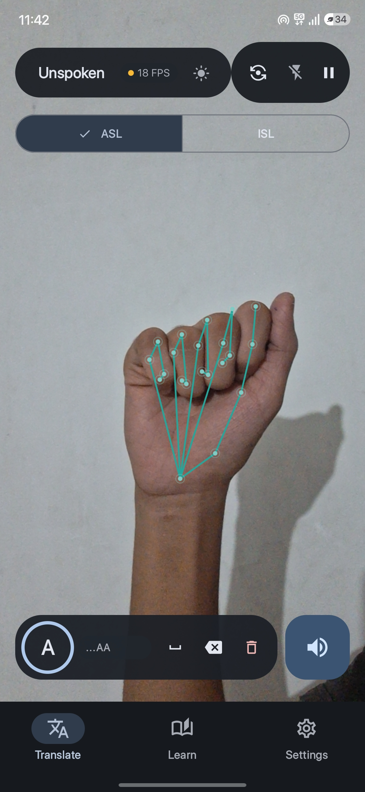
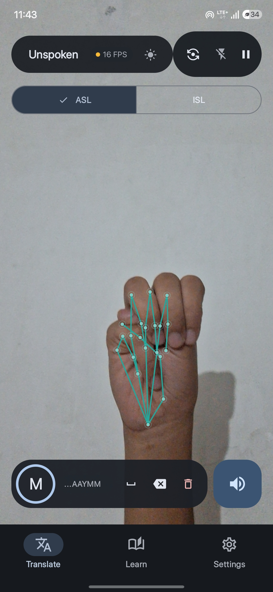
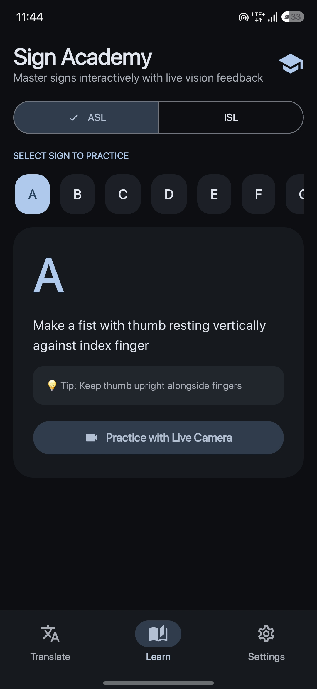
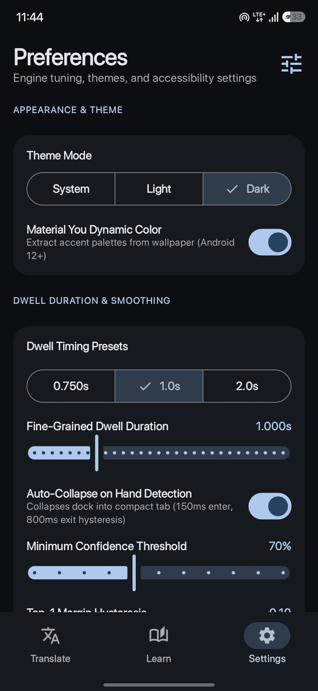
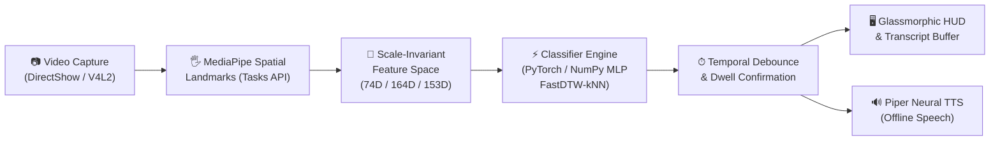

# Signora

```
  ███████╗██╗ ██████╗ ███╗   ██╗ ██████╗ ██████╗  █████╗
  ██╔════╝██║██╔════╝ ████╗  ██║██╔═══██╗██╔══██╗██╔══██╗
  ███████╗██║██║  ███╗██╔██╗ ██║██║   ██║██████╔╝███████║
  ╚════██║██║██║   ██║██║╚██╗██║██║   ██║██╔══██╗██╔══██║
  ███████║██║╚██████╔╝██║ ╚████║╚██████╔╝██║  ██║██║  ██║
  ╚══════╝╚═╝ ╚═════╝ ╚═╝  ╚═══╝ ╚═════╝ ╚═╝  ╚═╝╚═╝  ╚═╝
```


**Real-time sign language recognition. 100% local. Nothing leaves your machine.**

[](https://github.com/RAZOR-NINJAS/signora/actions)
[](https://www.python.org/)
[](docs/INSTALL.md)
[](LICENSE)
[](docs/ARCHITECTURE.md)
[-orange)](docs/ARCHITECTURE.md)

---

[Quick Install](#-quick-install) • [Core Modes](#-core-modes) • [Native Android App](#-native-android-app-unspoken) • [Modern Glassmorphic HUD](#-modern-glassmorphic-hud) • [Interactive TUI](#-interactive-terminal-dashboard-tui) • [How It Works](#-how-it-works) • [Controls](#-keyboard-controls) • [System Doctor](#-system-diagnostics) • [Benchmarks](#-performance-benchmarks) • [Documentation](#-documentation)

---

## 💡 Why Signora

- **100% Offline & Private:** Video frames never leave your computer. No cloud telemetry, no API keys, and no subscriptions.
- **Ultra-Lightweight & Fast:** Runs at 30+ FPS on entry-level laptops (even an AMD dual-core CPU with 3.7 GB RAM) using sub-millisecond neural classifiers.
- **Zero-Overhead Graphics:** Pure native C++/NumPy rendering. ROI-bounded alpha blending (<0.02 ms) ensures zero frame drops and zero HTML/webview overhead.
- **Multi-Dialect & Interactive:** First-class support for single-handed ASL, dual-handed Indian Sign Language (ISL), dynamic motion words, interactive browser drills, and a gesture-controlled runner game.
- **Full Windows & Linux Parity:** Zero administrator rights needed on Windows. Automatic DirectShow (`CAP_DSHOW`) and V4L2 kernel capture backends.

---

## 🚀 Quick Install

### Linux & macOS (One-Liner)
```bash
curl -fsSL https://raw.githubusercontent.com/RAZOR-NINJAS/signora/main/install.sh | bash
```

### Windows 10 & 11 (Non-Admin Barebones Laptop)
Open standard **Windows PowerShell** (no administrator rights needed) and run:
```powershell
irm https://raw.githubusercontent.com/RAZOR-NINJAS/signora/main/install.ps1 | iex
```

---

### Manual Installation (Step-by-Step)

```bash
# 1. Clone repository
git clone https://github.com/RAZOR-NINJAS/signora.git
cd signora

# 2. Create virtual environment with Python 3.11 or 3.12
python -m venv .venv
source .venv/bin/activate  # On Windows: .venv\Scripts\Activate.ps1

# 3. Install CPU-only PyTorch and package
pip install --upgrade pip
pip install torch torchvision --index-url https://download.pytorch.org/whl/cpu
pip install -e .

# 4. Download neural model weights
python scripts/fetch_models.py

# 5. Run health diagnostics
signora doctor
```

---

## 🎛 Core Modes

| Mode | Launch Command | Input & Tracking | Inference & Output Engine |
| :--- | :--- | :--- | :--- |
| **🤲 ASL Fingerspelling** | `signora live` | Single-handed 74D normalized landmarks | Sub-ms MLP • In-air SPACE dwell • Piper neural speech |
| **🤝 Indian Sign Language (ISL)** | `signora isl` | Dual-handed 164D spatial contact geometry | 26 letters + 10 words • 0.43 ms NumPy MLP • Cybernetic skeletons |
| **🌊 ASL Dynamic Words** | `signora words` | 153D upper-body pose & hands trajectory | 16 dynamic signs • FastDTW-kNN sequence matching |
| **🦖 Shadow-Play Game** | `signora game --kiosk` | Real-time hand posture classification | Browser obstacle runner • Jump/crouch gestures |
| **🎓 Learning Kiosk** | `signora learn --kiosk` | Real-time posture tracking vs reference signs | Interactive drills • Visual guides • Timed sign quizzes |
| **🔔 Environmental Alert** | `signora alert` | 16 kHz real-time spectral acoustic monitoring | Doorbell, knocks, alarms, calls • Pulsing HUD & desktop daemon |
| **🩺 System Doctor** | `signora doctor` | Automated 10-point self-test suite | Camera backends, model weights, audio, loopback |

---

## 🔔 SIGNORA Alert: Hear Through Your Eyes

Assistive environmental acoustic perception designed specifically for Deaf and Hard of Hearing individuals. 100% offline edge audio processing detects household sounds and translates them into vivid visual notifications and peripheral screen strobes.

- **Detectable Sound Signatures:**
  - 🔔 **Doorbell / Intercom Chimes:** Dual-tone resonant harmonics (600–900 Hz).
  - 🚪 **Door Knocks:** Rhythmic low-frequency acoustic transient onset strikes (100–750 Hz).
  - 🚨 **Siren / Fire Alarms:** Continuous or pulsed high-frequency alarm tones (2.4–3.8 kHz) with immediate critical urgency.
  - 🗣️ **Human Calls:** Formant harmonic energy spikes (someone calling out or shouting for attention).
- **Background Daemon:** Runs silently in the background using minimal CPU (<1%), triggering native desktop notifications via `notify-send` (Linux) or Windows Toast notifications.
- **Glassmorphic Visual HUD:** Live audio decibel meter (dB SPL), spectral energy breakdown bars, recent event history, and full-screen pulsing strobe border during active alerts.

```bash
# Launch interactive visual monitor with HUD
signora alert

# Start background audio monitoring daemon
signora alert --start

# Check daemon running status and recent alerts
signora alert --status

# Stop background daemon
signora alert --stop

# Send a test visual alert
signora alert --test
```

---

## 📱 Native Android App (Unspoken)

Signora features a native companion app for Android (**Unspoken.apk** / **Signora.apk**), built with Jetpack Compose, CameraX, and Google MediaPipe Tasks Vision:

- **100% On-Device Neural Inference:** Sub-0.2ms forward pass using a custom pure-Kotlin neural MLP with zero heavy C++/NDK bloat.
- **Hardware Matrix Upright Blit:** Real-time portrait transformation with zero per-frame heap allocations (<1.0ms) ensures pixel-perfect landmark tracking on front-facing cameras.
- **Material 3 Expressive Design:** Hand-aware auto-collapsing navigation bar with 150ms enter / 800ms exit hysteresis, floating status pill, and Sign Academy.

| Live ASL Translation ('A') | Live ASL Translation ('M') | Sign Academy (Learn Mode) | Material 3 Preferences |
| :---: | :---: | :---: | :---: |
|  |  |  |  |

Download the pre-compiled APK directly from the [latest GitHub Release](https://github.com/RAZOR-NINJAS/signora/releases/latest).

---

## 🖥 Modern Glassmorphic HUD

Signora features a custom, high-polish OpenCV HUD built without HTML or heavy webview runtimes:

- **Ultra-Low CPU Overhead:** Replaced full-frame cloning with in-place bounding-box ROI slicing. Blending takes `<0.02 ms` per card.
- **Cybernetic Hand Skeletons:** Dual-hand color differentiation (electric cyan `#06b6d4` for Left Hand, neon magenta `#ec4899` for Right Hand) with anti-aliased glowing fingertip halos and wrist badge tags.
- **Top Status Pill:** Floating pill with real-time FPS counter, inference delegate (`CPU`), and live pulsing status dot.
- **Prediction Card & Dwell Meter:** Anti-aliased floating card displaying target sign, confidence score, and smooth neon dwell confirmation ring.
- **Transcript Console:** Floating bottom bar with keycap hotkey badges (`[C] Clear`, `[R] Speak`, `[Bksp] Undo`, `[F] Fullscreen`, `[Q] Quit`).
- **Piper Speech Toast:** Dynamic emerald audio popup (`🔊 SPEAKING: "..."`) during voice synthesis.

---

## 📟 Interactive Terminal Dashboard (TUI)

Launch the interactive console interface with arrow keys and numeric menus:

```bash
signora tui
# or simply run:
signora
```

```
  ███████╗██╗ ██████╗ ███╗   ██╗ ██████╗ ██████╗  █████╗
  ██╔════╝██║██╔════╝ ████╗  ██║██╔═══██╗██╔══██╗██╔══██╗
  ███████╗██║██║  ███╗██╔██╗ ██║██║   ██║██████╔╝███████║
  ╚════██║██║██║   ██║██║╚██╗██║██║   ██║██╔══██╗██╔══██║
  ███████║██║╚██████╔╝██║ ╚████║╚██████╔╝██║  ██║██║  ██║
  ╚══════╝╚═╝ ╚═════╝ ╚═╝  ╚═══╝ ╚═════╝ ╚═╝  ╚═╝╚═╝  ╚═╝

  SIGNORA    100% Offline • Edge Neural Inference • Zero Cloud Latency

╭─ System Hardware & Inference Architecture ───────────────────────────────────────╮
│ Version:          v0.1.2                   Processor:        2 Cores (x86_64)    │
│ Operating System: Linux                    System Memory:    3.7 GB RAM          │
│ Python Runtime:   3.11.16                  Video Backend:    V4L2 (0-Copy Kernel)│
│ Neural Engine:    PyTorch / NumPy CPU      Piper TTS Voice:  Active (en_US)      │
╰──────────────────────────────────────────────────────────────────────────────────╯

╭─ Interactive Operations & Recognition Modes ─────────────────────────────────────╮
│  Key   Operation / Mode             Architecture & Features         CPU Cost     │
│ ────── ──────────────────────────── ─────────────────────────────── ─────────── │
│  ---   SIGN RECOGNITION ENGINES     Real-time HUD with Piper speech ---          │
│   1    ASL Fingerspelling           Single-hand (A-Z + SPACE dwell) Low (~8%)    │
│   2    Indian Sign Language         Dual-handed 164D geometry       Low (~10%)   │
│   3    ASL Dynamic Words            16-word trajectory FastDTW-kNN  Med (~18%)   │
│  ---   INTERACTIVE BROWSER LABS     Local web app on localhost:8000 ---          │
│   4    Shadow-Play Game             Gesture-controlled Dino runner  Low (~12%)   │
│   5    Interactive Learning Kiosk   Posture drills & timed quizzes  Low (~12%)   │
│  ---   KNOWLEDGE & PREFERENCES      Visual dictionary & settings    ---          │
│   G    Gesture Sign Dictionary      Visual hand postures & motion   Reference    │
│   S    Session Settings             Dwell time, voice TTS, camera   Config       │
│  ---   DIAGNOSTICS & UTILITIES      Hardware & model validation     ---          │
│   6    System Doctor                Automated 10-point self-test    Instant      │
│   7    Model Asset Manager          Inspect / fetch neural weights  I/O Bound    │
│   8    Hardware Camera Probe        Scan connected video devices    Instant      │
│   9    Live Camera & HUD Test       5-second live camera test bench Real-time    │
│   A    Auto-Repair & Self-Healing   Auto-repair models, cam, audio  Instant      │
│   0    Exit Signora                 Close interactive dashboard     —            │
╰──────────────────────────────────────────────────────────────────────────────────╯
```

---

## 🔬 How It Works



1. **Hardware Capture:** OpenCV captures video with `buffer_size=1` for lowest latency via V4L2 on Linux and DirectShow (`CAP_DSHOW`) on Windows.
2. **Spatial Landmark Tracking:** MediaPipe Tasks API detects 21 3D hand keypoints and upper-body joints.
3. **Geometric Normalization:** Coordinates are centered at the wrist/shoulders and scaled by hand span for zero calibration across different people and camera distances.
4. **Sub-Millisecond Inference:** Compact neural architectures classify hand shapes in < 1 ms on CPU.
5. **Dwell Confirmation:** An 800 ms hold window ensures transitional hand movements do not cause false positives.
6. **Piper Neural Voice:** Confirmed sentences are synthesized asynchronously via local Piper neural text-to-speech.

---

## ⌨️ Keyboard Controls

When running in HUD recognition mode (`signora live`, `signora isl`, or `signora words`):

| Key | Action | Behavior |
| :---: | :--- | :--- |
| **`ESC`** or **`Q`** | Quit | Closes video capture stream and exits cleanly. |
| **`SPACE`** | Vocalize | Synthesizes current transcript aloud via Piper neural speech. |
| **`BACKSPACE`** | Undo | Erases the last confirmed character from transcript. |
| **`C`** | Clear | Empties the entire transcript buffer. |
| **`F`** | Fullscreen | Toggles high-contrast fullscreen HUD view. |

---

## 🩺 System Diagnostics

Run `signora doctor` anytime to verify that hardware, neural models, audio devices, and network stacks are operating correctly:

### Verified Diagnostic Output (10 Checks)

```
=== Signora System Doctor & Compatibility Diagnostics ===

┏━━━━━━━━━━━━━━━━┳━━━━━━━━━━━━━━━━━━━━━━━━━━━━┳━━━━━━━━━━━━┳━━━━━━━━━━━━━━━━━━━━━━━━━━━━━━━━━━━━━━━━━┓
┃ Category       ┃ Component                  ┃ Status     ┃ Details                                 ┃
┡━━━━━━━━━━━━━━━━╇━━━━━━━━━━━━━━━━━━━━━━━━━━━━╇━━━━━━━━━━━━╇━━━━━━━━━━━━━━━━━━━━━━━━━━━━━━━━━━━━━━━━━┩
│ Environment    │ Python Runtime             │ PASS       │ 3.11.16 (/home/vaibhav/Projects/signora)│
│ Environment    │ Operating System           │ PASS       │ Linux (linux, x86_64) - V4L2 backend    │
│ Hardware       │ Webcam Capture             │ PASS       │ Found 1 camera(s) via V4L2: Cam 0       │
│ Vision         │ MediaPipe Landmarker       │ PASS       │ Loaded hand_landmarker.task (Tasks API) │
│ Models         │ ASL Letters Mode           │ PASS       │ Model present: signs_mlp.pt             │
│ Models         │ ISL Mode (Two-Handed)      │ PASS       │ Weights present: isl_mlp.pt             │
│ Models         │ ASL Words Mode             │ PASS       │ Classifier present: words_classifier.npz│
│ Audio          │ Text-to-Speech (Piper)     │ PASS       │ Piper voice present & audio device ready│
│ Display        │ Browser Kiosk              │ PASS       │ Detected: chromium (/usr/bin/chromium)  │
│ Network        │ Localhost Loopback         │ PASS       │ Loopback operational (ephemeral port)   │
└────────────────┴────────────────────────────┴────────────┴─────────────────────────────────────────┘

All core systems are operational and ready for use!
```

---

## 📊 Performance Benchmarks

Measured on an entry-level development machine (**AMD A6-9220 2-core CPU @ 2.5 GHz, 3.7 GB RAM, no GPU**, Arch Linux):

| Benchmark Metric | Measured Result | Notes |
| :--- | :--- | :--- |
| **ISL NumPy Forward Pass** | **0.43 ms** | Pure vectorized NumPy with analytical GELU |
| **ASL PyTorch Forward Pass** | **0.82 ms** | Lightweight 3-layer MLP on CPU |
| **FastDTW Sequence Match** | **14.2 ms** | 16-word trajectory comparison |
| **Glassmorphic HUD Drawing** | **< 0.02 ms** | Localized ROI slicing (zero full-frame copying) |
| **End-to-End Frame Latency** | **~28 ms** | Real-time 30+ FPS video throughput |
| **Memory Footprint (RSS)** | **~135 MB** | Substantially lower than browser-only JS tools |
| **Startup Time (TUI)** | **< 30 ms** | Instant console initialization |

---

## 📚 Documentation

- [System Architecture Deep-Dive](docs/ARCHITECTURE.md) — Mathematical representations, feature vector formulas, and pipeline internals.
- [Cross-Platform Installation Guide](docs/INSTALL.md) — Detailed manual setup for Arch, Ubuntu, Fedora, macOS, and Windows.
- [Complete Sign Catalog](docs/SIGNS.md) — Step-by-step hand posture guide for all ASL, ISL, and Words signs.
- [Windows Non-Admin QA Checklist](docs/WINDOWS-TEST-CHECKLIST.md) — Complete validation checklist for barebones Windows laptops.
- [Troubleshooting & Remediation](docs/TROUBLESHOOTING.md) — Solutions for camera permissions, audio drivers, and frame skipping.

---

## 📄 License

Signora is open-source software licensed under the [MIT License](LICENSE).  
Copyright (c) 2026 Vaibhav Singh Shekhawat.
