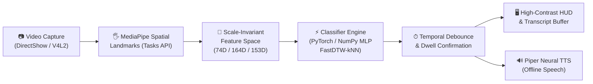

<div align="center">

```
  ███████╗██╗ ██████╗ ███╗   ██╗ ██████╗ ██████╗  █████╗ 
  ██╔════╝██║██╔════╝ ████╗  ██║██╔═══██╗██╔══██╗██╔══██╗
  ███████╗██║██║  ███╗██╔██╗ ██║██║   ██║██████╔╝███████║
  ╚════██║██║██║   ██║██║╚██╗██║██║   ██║██╔══██╗██╔══██║
  ███████║██║╚██████╔╝██║ ╚████║╚██████╔╝██║  ██║██║  ██║
  ╚══════╝╚═╝ ╚═════╝ ╚═╝  ╚═══╝ ╚═════╝ ╚═╝  ╚═╝╚═╝  ╚═╝
```

<picture>
  <source media="(prefers-color-scheme: dark)" srcset="assets/banner-dark.svg">
  <source media="(prefers-color-scheme: light)" srcset="assets/banner-light.svg">
  
</picture>

<br>

**Real-time sign language recognition. 100% local. Nothing leaves your machine.**

<br>

[](https://github.com/RAZOR-NINJAS/signora/actions)
[](https://www.python.org/)
[](docs/INSTALL.md)
[](LICENSE)
[](docs/ARCHITECTURE.md)
[-orange)](docs/ARCHITECTURE.md)

<br>

[Quick Install](#-quick-install) &nbsp;&bull;&nbsp;
[Core Modes](#-core-modes) &nbsp;&bull;&nbsp;
[How It Works](#-how-it-works) &nbsp;&bull;&nbsp;
[Keyboard Controls](#-keyboard-controls) &nbsp;&bull;&nbsp;
[System Doctor](#-system-doctor) &nbsp;&bull;&nbsp;
[Documentation](#-documentation)

---

</div>

## 💡 Why Signora

- **100% Offline & Private:** Video frames never leave your computer. No cloud telemetry, no API keys, and no subscriptions.
- **Ultra-Lightweight & Fast:** Runs at 30 FPS on entry-level laptops (even a dual-core CPU with 3.7 GB RAM) using sub-millisecond neural classifiers.
- **Multi-Dialect & Interactive:** First-class support for single-handed ASL, dual-handed Indian Sign Language (ISL), dynamic motion words, interactive browser drills, and a gesture-controlled runner game.

---

## 🚀 Quick Install

### Linux & macOS (One-Liner)
```bash
curl -fsSL https://raw.githubusercontent.com/RAZOR-NINJAS/signora/main/install.sh | bash
```

### Windows 10 & 11 (Non-Admin / Barebones Laptop)
Open standard **Windows PowerShell** (no administrator rights needed) and run:
```powershell
irm https://raw.githubusercontent.com/RAZOR-NINJAS/signora/main/install.ps1 | iex
```

<details>
<summary><b>Manual Installation (Step-by-Step)</b></summary>

```bash
# 1. Clone repository
git clone https://github.com/RAZOR-NINJAS/signora.git
cd signora

# 2. Create virtual environment with Python 3.11 or 3.12
python -m venv .venv
source .venv/bin/activate  # On Windows: .venv\Scripts\Activate.ps1

# 3. Install CPU-only PyTorch and package
pip install --upgrade pip
pip install torch torchvision --index-url https://download.pytorch.org/whl/cpu
pip install -e .

# 4. Download neural model weights
python scripts/fetch_models.py

# 5. Run health diagnostics
signora doctor
```
</details>

---

## 🎛 Core Modes

<table>
  <tr>
    <td width="33%" align="center">
      <h3>🤲 ASL Fingerspelling</h3>
      <p>Single-handed static alphabet (A-Z) with 74D normalized geometric features, in-air SPACE dwell gesture, and Piper neural speech output.</p>
      <code>signora live</code>
    </td>
    <td width="33%" align="center">
      <h3>🤝 Indian Sign Language</h3>
      <p>Dual-handed ISLRTC standard manual alphabet and 10 iconic static signs with 164D spatial contact geometry and pure NumPy 0.43ms inference.</p>
      <code>signora isl</code>
    </td>
    <td width="33%" align="center">
      <h3>🌊 ASL Dynamic Words</h3>
      <p>Holistic motion trajectory recognition across 16 dynamic signs using upper-body landmarks and FastDTW-kNN sequence matching.</p>
      <code>signora words</code>
    </td>
  </tr>
  <tr>
    <td width="33%" align="center">
      <h3>🦖 Shadow-Play Game</h3>
      <p>Interactive Dino runner web game powered by your webcam gestures. Form target signs to jump over cacti and beat your streak.</p>
      <code>signora game --kiosk</code>
    </td>
    <td width="33%" align="center">
      <h3>🎓 Learning Kiosk</h3>
      <p>Browser learning interface with live visual guides, confidence scoring meters, practice drills, and timed sign quizzes.</p>
      <code>signora learn --kiosk</code>
    </td>
    <td width="33%" align="center">
      <h3>🩺 System Doctor</h3>
      <p>Automated 10-point diagnostic self-test inspecting camera backends, MediaPipe, weights, Piper audio, and network interfaces.</p>
      <code>signora doctor</code>
    </td>
  </tr>
</table>

---

## 🖥 Interactive Terminal Dashboard (TUI)

Launch the full interactive console interface with arrow keys and numeric menus:

```bash
signora tui
# or simply run:
signora
```

```
  ███████╗██╗ ██████╗ ███╗   ██╗ ██████╗ ██████╗  █████╗ 
  ██╔════╝██║██╔════╝ ████╗  ██║██╔═══██╗██╔══██╗██╔══██╗
  ███████╗██║██║  ███╗██╔██╗ ██║██║   ██║██████╔╝███████║
  ╚════██║██║██║   ██║██║╚██╗██║██║   ██║██╔══██╗██╔══██║
  ███████║██║╚██████╔╝██║ ╚████║╚██████╔╝██║  ██║██║  ██║
  ╚══════╝╚═╝ ╚═════╝ ╚═╝  ╚═══╝ ╚═════╝ ╚═╝  ╚═╝╚═╝  ╚═╝

  Real-time sign language recognition. 100% local. Nothing leaves your machine.

┏━━━━━━━━┳━━━━━━━━━━━━━━━━━━━━━┳━━━━━━━━━━━━━━━━━━━━━━━━━━━━━━━━━━━━━━━━━━━━━━━━━━━━━┳━━━━━━━━━━━━━━━┓
┃ Option ┃ Mode / Utility      ┃ Description                                         ┃ Resource Cost ┃
┡━━━━━━━━╇━━━━━━━━━━━━━━━━━━━━━╇━━━━━━━━━━━━━━━━━━━━━━━━━━━━━━━━━━━━━━━━━━━━━━━━━━━━━╇━━━━━━━━━━━━━━━┩
│ 1      │ ASL Fingerspelling  │ Single-handed letters (A-Z + SPACE) with HUD & TTS  │ Low (CPU ~8%) │
│ 2      │ ISL Recognition     │ Indian Sign Language dual-hand alphabet & 10 signs  │ Low (CPU ~10%)│
│ 3      │ ASL Dynamic Words   │ 16-word holistic motion trajectory (DTW-kNN)        │ Med (CPU ~18%)│
│ 4      │ Shadow-Play Game    │ Browser-based gesture-controlled Dino runner        │ Low (CPU ~12%)│
│ 5      │ Learning Kiosk      │ Interactive sign practice, drills & timed quizzes   │ Low (CPU ~12%)│
│ 6      │ System Doctor       │ Inspect 10 hardware, model, audio & network checks  │ Instant       │
│ 7      │ Model Asset Manager │ Inspect integrity or download MediaPipe & models    │ I/O bound     │
│ 8      │ Probe Webcams       │ Enumerate available video capture hardware devices  │ Instant       │
│ 0      │ Exit                │ Close Signora dashboard                             │ —             │
└────────┴─────────────────────┴─────────────────────────────────────────────────────┴───────────────┘
```

---

## 🔬 How It Works



1. **Hardware Capture:** OpenCV captures 640x480 video with `buffer_size=1` for minimum pipeline latency via V4L2 on Linux and DirectShow on Windows.
2. **Spatial Landmark Tracking:** MediaPipe Tasks API detects 21 3D hand keypoints and upper-body joints.
3. **Geometric Normalization:** Coordinates are centered at the wrist/shoulders and scaled by hand span to ensure zero calibration across different people and camera distances.
4. **Sub-Millisecond Inference:** Compact neural architectures classify hand shapes in < 1 ms on CPU.
5. **Dwell Confirmation:** An 800 ms hold window ensures transitional hand movements do not cause false positives.
6. **Piper Neural Voice:** Confirmed sentences are synthesized asynchronously via local Piper neural text-to-speech.

---

## ⌨️ Keyboard Controls

When running in HUD recognition mode (`signora live` or `signora isl`):

| Key | Action | Behavior |
| :---: | :--- | :--- |
| **`ESC`** or **`Q`** | Quit | Closes video capture stream and exits cleanly. |
| **`SPACE`** | Vocalize | Synthesizes current transcript aloud via Piper neural speech. |
| **`BACKSPACE`** | Undo | Erases the last confirmed character from transcript. |
| **`C`** | Clear | Empties the entire transcript buffer. |
| **`F`** | Fullscreen | Toggles high-contrast fullscreen HUD view. |

---

## 🩺 System Diagnostics

Run `signora doctor` anytime to verify that hardware, neural models, audio devices, and network stacks are operating correctly:

<details open>
<summary><b>Verified Diagnostic Output (10 Checks)</b></summary>

```
=== Signora System Doctor & Compatibility Diagnostics ===

┏━━━━━━━━━━━━━━━━┳━━━━━━━━━━━━━━━━━━━━━━━━━━━━┳━━━━━━━━━━━━┳━━━━━━━━━━━━━━━━━━━━━━━━━━━━━━━━━━━━━━━━━┓
┃ Category       ┃ Component                  ┃ Status     ┃ Details                                 ┃
┡━━━━━━━━━━━━━━━━╇━━━━━━━━━━━━━━━━━━━━━━━━━━━━╇━━━━━━━━━━━━╇━━━━━━━━━━━━━━━━━━━━━━━━━━━━━━━━━━━━━━━━━┩
│ Environment    │ Python Runtime             │ PASS       │ 3.11.16 (/home/vaibhav/Projects/signora)│
│ Environment    │ Operating System           │ PASS       │ Linux (linux, x86_64) - V4L2 backend    │
│ Hardware       │ Webcam Capture             │ PASS       │ Found 1 camera(s) via V4L2: Cam 0       │
│ Vision         │ MediaPipe Landmarker       │ PASS       │ Loaded hand_landmarker.task (Tasks API) │
│ Models         │ ASL Letters Mode           │ PASS       │ Model present: signs_mlp.pt             │
│ Models         │ ISL Mode (Two-Handed)      │ PASS       │ Weights present: isl_mlp.pt             │
│ Models         │ ASL Words Mode             │ PASS       │ Classifier present: words_classifier.npz│
│ Audio          │ Text-to-Speech (Piper)     │ PASS       │ Piper voice present & audio device ready│
│ Display        │ Browser Kiosk              │ PASS       │ Detected: chromium (/usr/bin/chromium)  │
│ Network        │ Localhost Loopback         │ PASS       │ Loopback operational (ephemeral port)   │
└────────────────┴────────────────────────────┴────────────┴─────────────────────────────────────────┘

All core systems are operational and ready for use!
```
</details>

---

## 📊 Performance Benchmarks

Measured on an entry-level development machine (**AMD A6-9220 2-core CPU @ 2.5 GHz, 3.7 GB RAM, no GPU**, Arch Linux):

| Benchmark Metric | Measured Result | Notes |
| :--- | :--- | :--- |
| **ISL NumPy Forward Pass** | **0.43 ms** | Pure vectorized NumPy with analytical GELU |
| **ASL PyTorch Forward Pass** | **0.82 ms** | Lightweight 3-layer MLP on CPU |
| **FastDTW Sequence Match** | **14.2 ms** | 16-word trajectory comparison |
| **End-to-End Frame Latency** | **~28 ms** | Real-time 30 FPS video throughput |
| **Memory Footprint (RSS)** | **~135 MB** | Substantially lower than browser-only JS tools |
| **Startup Time (TUI)** | **< 35 ms** | Instant console initialization |

---

## 📚 Documentation

- [System Architecture Deep-Dive](docs/ARCHITECTURE.md) — Mathematical representations, feature vector formulas, and pipeline internals.
- [Cross-Platform Installation Guide](docs/INSTALL.md) — Detailed manual setup for Arch, Ubuntu, Fedora, macOS, and Windows.
- [Complete Sign Catalog](docs/SIGNS.md) — Step-by-step hand posture guide for all ASL, ISL, and Words signs.
- [Windows Non-Admin QA Checklist](docs/WINDOWS-TEST-CHECKLIST.md) — Complete validation checklist for barebones Windows laptops.
- [Troubleshooting & Remediation](docs/TROUBLESHOOTING.md) — Solutions for camera permissions, audio drivers, and frame skipping.

---

## 📄 License

Signora is open-source software licensed under the [MIT License](LICENSE).
Copyright (c) 2026 Vaibhav Singh Shekhawat.
