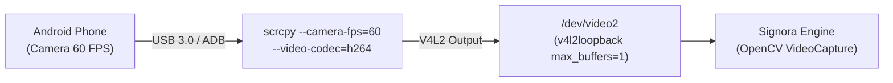

# `signora phone`

> [!INFO] Summary
> **One-Command Zero-Latency Phone Webcam Bridge**. Connects an Android smartphone via USB, launches `scrcpy` in camera-stream mode directly into a kernel `v4l2loopback` sink with single-buffer latency optimization, and dispatches the high-resolution 60 FPS video stream into Signora.

---

## 1. Syntax

```bash
signora phone [MODE] [OPTIONS]
```

Where `[MODE]` can be:
- `isl` (default) — Indian Sign Language dual-handed recognition.
- `body` — Whole-body pose and spatial placement anchors.
- `asl` — American Sign Language fingerspelling.
- `words` — Dynamic motion gesture recognition.

---

## 2. Common Usage Examples

### Instant Phone ISL Recognition
```bash
# Connect phone via USB, enable USB debugging, and run:
signora phone isl
# or simply
signora phone
```

### Phone Camera with Whole-Body Pose & Spatial Anchors
```bash
signora phone body
```

### Phone Camera ASL Fingerspelling
```bash
signora phone asl
```

### Switch to Front Selfie Camera
```bash
# By default uses rear back camera (higher quality)
# Use --facing front for laptop/desk setups:
signora phone isl --facing front
```

### Ultra-Fluid Dwell Override
```bash
signora phone isl --dwell 200
```

### Silent Mode (No TTS Audio)
```bash
signora phone isl --no-tts
```

---

## 3. How the Zero-Latency Pipeline Works



1. **Automated Phone Handshake**: Checks `adb devices` for authorized physical devices.
2. **Kernel V4L2 Device Auto-Configuration**: Ensures `v4l2loopback` is loaded with `max_buffers=1` to completely eliminate frame lag.
3. **Hardware-Accelerated Camera Stream**: Launches `scrcpy` with `--v4l2-sink`, `--no-audio`, `--camera-facing`, and `--camera-fps=60`.
4. **Auto-Cleanup**: When you press `q` or `ESC` in Signora, the scrcpy background process is cleanly terminated.

---

## 4. Options & Flags

| Flag | Type | Default | Description |
|---|---|---|---|
| `mode` | Positional | `isl` | Recognition mode: `isl`, `body`, `asl`, `words` |
| `--facing` | `back` \| `front` | `back` | Camera sensor to use on the phone |
| `--res`, `--resolution` | String | `720p` | Resolution preset: `720p`, `480p`, `360p`, `1080p` |
| `--dwell` | Integer | `250` | Hold dwell duration in milliseconds |
| `--detect-every` | Integer | `2` | Landmark detection interval in frames |
| `--no-tts` | Flag | `False` | Disable Piper neural text-to-speech audio |

---

## 5. Prerequisites & Troubleshooting

### System Dependencies
Ensure `adb` and `scrcpy` are installed on your Linux host:
```bash
sudo apt update
sudo apt install -y android-tools-adb scrcpy v4l2loopback-dkms
```

### Phone Setup (One-Time)
1. Open phone **Settings** $\to$ **About Phone** $\to$ tap **Build Number** 7 times to enable Developer Options.
2. Go to **Developer Options** $\to$ turn on **USB Debugging**.
3. Plug the phone into your PC via USB cable.
4. Unlock the phone screen. A prompt will appear: tap **"Always allow from this computer"** and **"Allow"**.

### Troubleshooting Checks
```bash
# Verify ADB sees the phone in 'device' state:
adb devices -l

# If shown as 'unauthorized', unlock phone screen and approve prompt.
# If no device appears, check cable or restart ADB:
adb kill-server && adb start-server
```

---

## 6. Related Commands
- [[signora isl]] — ISL recognition details.
- [[signora body]] — Whole-body pose and spatial anchor details.
- [[signora asl]] — ASL fingerspelling details.
- [[adb commands]] — ADB command-line reference.
- [[signora stream]] — Broadcast virtual webcam to Zoom/Meet.
