# Signora Command Hub

> [!INFO] Interactive Obsidian Command Vault
> This vault contains actionable documentation, syntax guides, flags, options, and troubleshooting playbooks for every command in the Signora ecosystem.

---

## Command Map

```mermaid
graph TD
    Index["Commands Hub"]
    
    Index --> Recog["01 - Core Recognition"]
    Index --> Hard["02 - Hardware & Camera"]
    Index --> Audio["03 - Audio & Speech"]
    Index --> Train["04 - Training & Data"]
    Index --> Inter["05 - Interactive & Games"]
    Index --> Diag["06 - Diagnostics & Tools"]
    Index --> Andr["07 - Android Tooling"]
    Index --> Test["08 - Testing & QA"]
    
    Recog --> ISL["[[signora isl]]"]
    Recog --> Body["[[signora body]]"]
    Recog --> ASL["[[signora asl]]"]
    Recog --> Words["[[signora words]]"]
    
    Hard --> Phone["[[signora phone]]"]
    Hard --> Stream["[[signora stream]]"]
    
    Audio --> Alert["[[signora alert]]"]
    Audio --> Lip["[[signora lipsync]]"]
    
    Train --> Col["[[signora collect]]"]
    Train --> Tr["[[signora train]]"]
    Train --> Data["[[signora dataset]]"]
    
    Inter --> Game["[[signora game]]"]
    Inter --> Learn["[[signora learn]]"]
    
    Diag --> Doc["[[signora doctor]]"]
    Diag --> Mod["[[signora models]]"]
    Diag --> TUI["[[signora tui]]"]
    
    Andr --> Grad["[[android gradlew]]"]
    Andr --> ADB["[[adb commands]]"]
    
    Test --> Pytest["[[pytest commands]]"]
```

---

## 1. Quick Launch Matrix

| Action | Primary Command | Alternative / Alias | Target Note |
|---|---|---|---|
| **Indian Sign Language** | `signora isl` | `signora isl --dwell 250` | [[signora isl]] |
| **Upper-Body Spatial** | `signora body` | `signora spatial` | [[signora body]] |
| **Phone as Zero-Latency Webcam** | `signora phone isl` | `signora isl --phone` | [[signora phone]] |
| **ASL Fingerspelling** | `signora asl` | `signora live` | [[signora asl]] |
| **Dynamic Words (DTW-kNN)** | `signora words` | `signora phone words` | [[signora words]] |
| **Virtual Webcam (Zoom/Meet/Teams)** | `signora stream` | `signora vcam` | [[signora stream]] |
| **Sound Alert (Doorbell, Siren)** | `signora alert` | `signora listen` | [[signora alert]] |
| **Lip Sync & Visual Speech** | `signora lipsync` | `signora lip` | [[signora lipsync]] |
| **Sample Collection Studio** | `signora collect -s A` | `signora studio` | [[signora collect]] |
| **PyTorch MLP Training** | `signora train` | `signora train --body` | [[signora train]] |
| **Dataset Import / Inspect** | `signora dataset inspect` | `signora dataset import` | [[signora dataset]] |
| **Shadow Dino Game Server** | `signora game` | `signora game --kiosk` | [[signora game]] |
| **Sign Language Learning Kiosk** | `signora learn` | `signora learn --kiosk` | [[signora learn]] |
| **System Health Inspection** | `signora doctor` | `signora doctor --check-only` | [[signora doctor]] |
| **Neural Weights Manager** | `signora models list` | `signora models fetch` | [[signora models]] |
| **Terminal UI Dashboard** | `signora tui` | `signora` *(no args)* | [[signora tui]] |
| **Android Build & Compile** | `./gradlew assembleDebug` | — | [[android gradlew]] |
| **Android Deploy & Debug** | `adb install -r ...` | `adb logcat -s Signora:*` | [[adb commands]] |
| **Test Suite Execution** | `pytest tests/` | `pytest tests/test_core_debounce.py` | [[pytest commands]] |

---

## 2. Directory Navigation

- [[signora isl]] — Dual-handed ISL static alphabet and 200 glosses.
- [[signora body]] — Upper-body anatomical placement anchors (Forehead, Chest, Chin, Throat, Shoulder).
- [[signora phone]] — Instant ADB camera streaming with scrcpy and v4l2loopback single-buffer latency.
- [[signora asl]] — Single-handed ASL alphabet with confusable pair hysteresis.
- [[signora words]] — Holistic dynamic gestures using Dynamic Time Warping (DTW-kNN).
- [[signora stream]] — Broadcast real-time sign language captions to Zoom, Meet, Teams, and OBS.
- [[signora alert]] — Acoustic event watcher: doorbell, fire sirens, knocks, and baby cries.
- [[signora lipsync]] — Visual lip reading and visual speech activity detection.
- [[signora collect]] — Interactive sample recording studio with countdown timers.
- [[signora train]] — PyTorch neural network training for 126D hand and 220D body models.
- [[signora dataset]] — Inspect and import mobile-recorded JSON datasets.
- [[signora game]] — Dual-handed gesture Dino runner web server.
- [[signora learn]] — Interactive learning drills and flashcard kiosk.
- [[signora doctor]] — Camera diagnostics, CUDA/ROCm/CPU checks, and dependency verification.
- [[signora models]] — Manifest weight verification, hashing, and offline downloads.
- [[signora tui]] — Cyberpunk Textual/Rich terminal dashboard.
- [[android gradlew]] — Gradle build tasks, clean compilation, and APK generation.
- [[adb commands]] — Device installation, package management, logcat tracing, and intent launch.
- [[pytest commands]] — Regression testing, debounce unit tests, and CI test verification.
